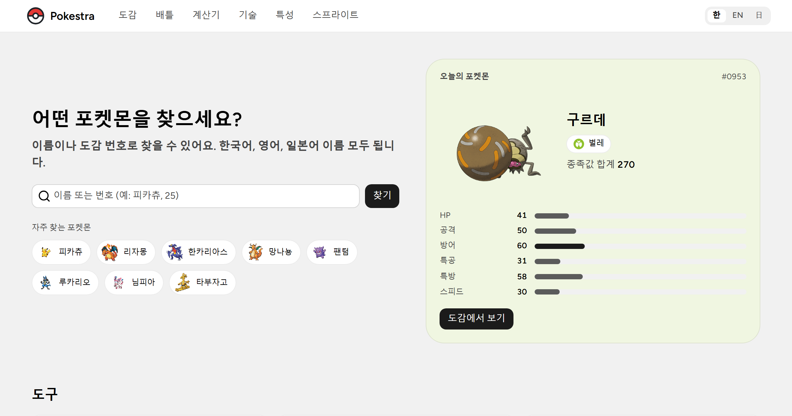
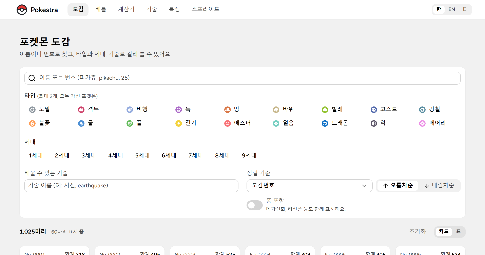

# Pokestra

[English](README.md) · **한국어**



**한국어·영어·일본어**를 지원하는 포켓몬 도감·데미지 계산기입니다. 1세대부터 9세대까지 모든 포켓몬을 다루고, 데미지 계산과 실능치는 [`@kyasi/pokebattle-engine`](https://github.com/2rangs/pokebattle-engine)으로 돌아갑니다.

배틀 시뮬레이터 데모는 엔진 저장소로 옮겼습니다: [2rangs/pokebattle-engine](https://github.com/2rangs/pokebattle-engine) playground (`#/battle`).

**사이트:** https://2rangs.github.io/portfolio/pokestra/

## 기능

| 경로 | 설명 |
|---|---|
| `/` | 첫 화면: 빠른 검색, 오늘의 포켓몬, 각 메뉴 바로가기 |
| `/pokedex` | 로컬 데이터로 바로 검색: 어느 언어로든 이름이나 번호로 찾기, 타입(최대 2개)·세대·배우는 기술·다른 폼 필터, 종족값 정렬 |
| `/pokemon/:id` | 상세 화면: 종족값, 특성, 타입 상성, 진화, 그리고 **실전 능력치 패널**(Lv50/Lv100 최소·최대 실능치), **세대 타임라인**(`?gen=N`: 세대별 스프라이트·타입·특성·종족값과 변경 표시, 울음소리) |
| `/calc` | **데미지 계산기**: 노력치/개체값, 성격, 특성, 도구, 랭크, 테라스탈, 날씨/필드/벽/급소. 16가지 데미지 난수와 확정 몇 타인지 보여 줌. `?atk=garchomp&def=gholdengo` 링크로 대결 조합을 미리 골라 둘 수 있음 |
| `/moves`, `/moves/:slug` | 기술 목록(타입·분류·세대 필터, 위력·명중·PP 정렬)과 설명·배우는 포켓몬이 있는 상세 화면 |
| `/abilities`, `/abilities/:slug` | 특성 목록과 설명·가진 포켓몬이 있는 상세 화면 |
| `/sprites` | 스프라이트 갤러리(일반/색이 다른 포켓몬, 도트/공식 일러스트) |



## 언어

머리말의 언어 전환으로 한국어 / English / 日本語를 고릅니다. 고른 언어는 `localStorage`에 저장되고, 처음 방문할 때는 브라우저 언어를 따릅니다.

- `src/i18n/index.ts` — 언어 상태와 `useT()` 훅
- `src/i18n/messages/*.ts` — 화면별 UI 문구. `defineMessages({ ko, en, ja })`는 `en`이나 `ja`에 빠진 키가 있으면 타입 검사에서 실패합니다
- 게임 데이터 이름(포켓몬, 기술, 특성, 타입, 도구, 성격)은 PokeAPI에서 가져오며, `src/lib/dex.ts`의 `displayName(p, lang)`, `moveName(slug, lang)` 같은 함수로 씁니다

## 디자인

UI는 [Astryx](https://astryx.atmeta.com) 디자인 시스템의 기본 `neutral` 테마로 만들었습니다.

- `src/styles.css`는 캐스케이드 레이어 순서를 정하고 Astryx 브리지와 함께 Tailwind v4를 불러옵니다. 그래서 `text-primary`, `bg-surface`, `border-border` 같은 유틸리티가 테마 토큰으로 이어집니다. `src/main.tsx`에서 가장 먼저 import해야 합니다.
- `src/main.tsx`는 앱을 Astryx `<Theme>`과, Astryx 링크를 React Router로 보내는 `<LinkProvider>`로 감쌉니다.
- `src/astryx-themes.ts`는 `npx astryx theme add` / `theme use`가 만드는 파일이니 직접 고치지 마세요.
- Astryx 사용 규칙은 `AGENTS.md`에 있고, `npx astryx component <이름>`으로 컴포넌트 props를 볼 수 있습니다.
- `src/components/ui/shared.tsx`에는 여러 화면이 같이 쓰는 작은 조각(페이지 제목, 타입 태그, 능력치 막대)이 있습니다.

## 개발

```bash
npm install
npm run dev      # http://localhost:5173/portfolio/pokestra/
npm run build
```

Node 20.19 이상이 필요합니다(Vite 8).

### 배포

사이트 주소는 https://2rangs.github.io/portfolio/pokestra/ 입니다. 이 저장소에는 배포 워크플로가 따로 없습니다. [2rangs.github.io](https://github.com/2rangs/2rangs.github.io) 저장소가 이 저장소의 `main`을 받아 `--base=/portfolio/pokestra/`로 빌드해서 함께 게시합니다. 그 워크플로는 그쪽 `main`에 푸시할 때, 6시간마다, 또는 직접 실행할 때(Actions → "Deploy Vite site to Pages" → Run workflow) 돌아갑니다.

### 데이터

`src/data/*.json`은 PokeAPI에서 만들어 커밋해 둔 파일입니다.

```bash
node src/script/fetchData.mjs       # 기본 데이터 (REST API, 느림)
node src/script/buildI18nData.mjs   # 영어/일본어 이름, 기술 상세, 특성, 성격, 도구 (PokeAPI CSV 덤프)
```

### 엔진 의존성

`package.json`은 엔진을 GitHub에서 설치합니다.

```json
"@kyasi/pokebattle-engine": "github:2rangs/pokebattle-engine#main"
```

설치할 때 npm이 엔진의 `prepare` 스크립트를 실행해 `dist/`를 빌드합니다. 두 저장소를 나란히 놓고 작업하려면:

```bash
# 엔진 저장소에서
npm pack
# Pokestra 저장소에서
npm install --no-save ../pokebattle-engine/kyasi-pokebattle-engine-*.tgz
```

## 구조

- `src/lib/dex.ts` — 로컬 도감 JSON(`src/data/*.json`)을 타입 있게 읽는 함수와 언어별 이름 함수
- `src/lib/battle.ts` — 엔진 연결: 데이터 불러오기 훅, 이름 변환, 도구/성격, 기술표로 만드는 추천 세트
- `src/pages/CalcPage.tsx`, `src/components/calc/` — 데미지 계산기
- 큰 화면은 지연 로딩(`React.lazy`)해서 데이터와 엔진은 필요할 때만 내려받습니다
