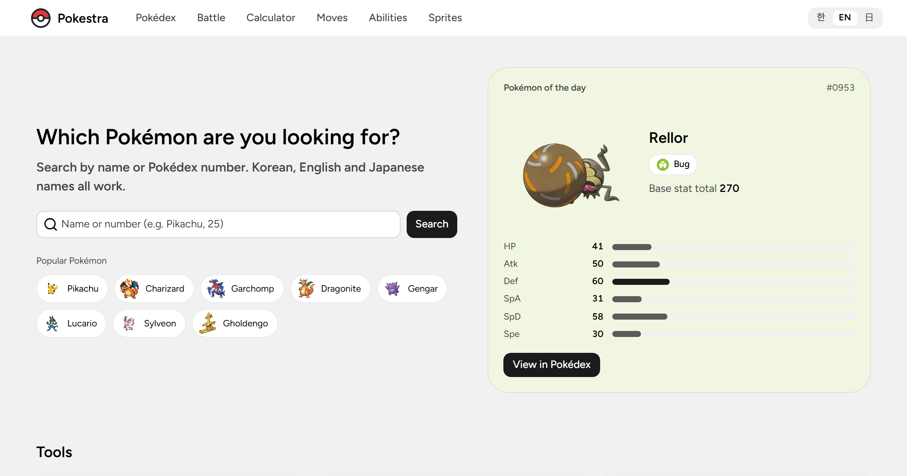
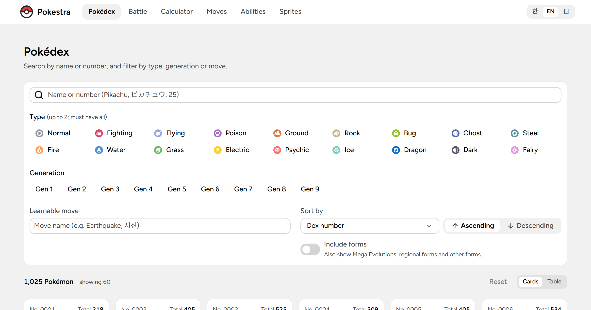

# Pokestra

**English** · [한국어](README.ko.md)



A Pokédex in **Korean, English and Japanese**. It covers every Pokémon from Gen 1 to 9 with moves, abilities, items and sprites, all from local data.

**Live site:** https://2rangs.github.io/portfolio/pokestra/

## Features

| Route | Description |
|---|---|
| `/` | Landing page: quick search, Pokémon of the day, section shortcuts |
| `/pokedex` | Instant search over local data: name in any language or number; filters for type (up to 2), generation, learnable moves and alternate forms; sorting by base stats |
| `/pokemon/:id` | Detail page: base stats, abilities, type matchups, evolutions, plus an **actual stats panel** (min/max actual stats at Lv50/Lv100), and a **generation timeline** (`?gen=N`: per-generation sprite, types, abilities and base stats with change markers, plus cries) |
| `/moves`, `/moves/:slug` | Move list with type/class/generation filters and power/accuracy/PP sorting; detail with description and learners |
| `/abilities`, `/abilities/:slug` | Ability list and detail with description and Pokémon that have it |
| `/sprites` | Sprite gallery (normal/shiny, sprite/official artwork) |



## Languages

The language switcher in the header picks 한국어 / English / 日本語. The choice is saved in `localStorage`; on the first visit it follows the browser language.

- `src/i18n/index.ts` — language store and `useT()` hook
- `src/i18n/messages/*.ts` — UI strings per screen. `defineMessages({ ko, en, ja })` fails type-checking if `en` or `ja` is missing a key
- Game data names (Pokémon, moves, abilities, types, items, natures) come from PokeAPI, through helpers like `displayName(p, lang)` and `moveName(slug, lang)` in `src/lib/dex.ts`

## Design

The UI is built on the [Astryx](https://astryx.atmeta.com) design system with its default `neutral` theme.

- `src/styles.css` declares the cascade-layer order and loads Tailwind v4 with the Astryx bridge, so utilities like `text-primary`, `bg-surface` and `border-border` map to theme tokens. It must be the first import in `src/main.tsx`.
- `src/main.tsx` wraps the app in Astryx `<Theme>` and a `<LinkProvider>` that routes Astryx links through React Router.
- `src/astryx-themes.ts` is generated by `npx astryx theme add` / `theme use`; don't edit it by hand.
- `AGENTS.md` has the Astryx conventions; `npx astryx component <Name>` prints a component's props.
- `src/components/ui/shared.tsx` holds the small pieces several pages share (page titles, type tags, stat bars).

## Development

```bash
npm install
npm run dev      # http://localhost:5173/portfolio/pokestra/
npm run build
```

Requires Node 20.19+ (Vite 8).

### Deployment

The site is served at https://2rangs.github.io/portfolio/pokestra/. This repo has no deploy workflow of its own: the [2rangs.github.io](https://github.com/2rangs/2rangs.github.io) repo checks out this repo's `main`, builds it with `--base=/portfolio/pokestra/` and publishes it. That workflow runs on a push to its own `main`, every 6 hours, or by hand (Actions → "Deploy Vite site to Pages" → Run workflow).

### Data

`src/data/*.json` is generated from PokeAPI and committed:

```bash
node src/script/fetchData.mjs       # base data (REST API, slow)
node src/script/buildI18nData.mjs   # en/ja names, move details, abilities, natures, items (PokeAPI CSV dump)
```

## Structure

- `src/lib/dex.ts` — typed accessors and per-language name helpers over the local dex JSON (`src/data/*.json`)
- `src/lib/stats.ts` — actual-stat formulas (HP / other stats, Lv, IV, EV, nature) used by the detail page's stats panel
- Large pages are lazy-loaded (`React.lazy`), so data downloads only when needed
